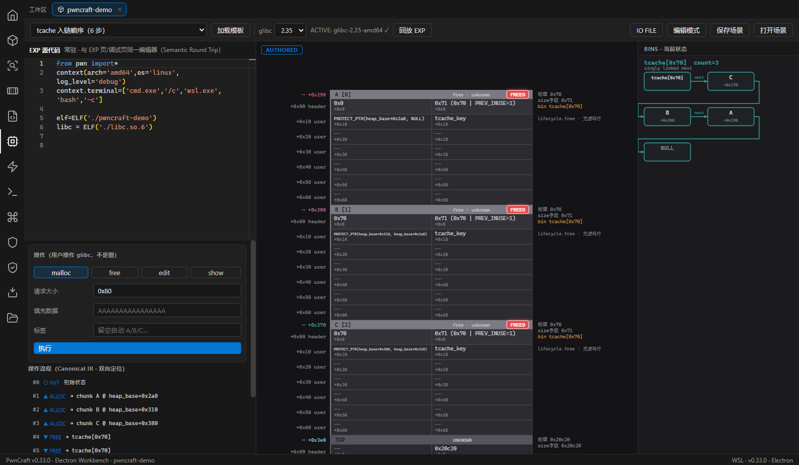
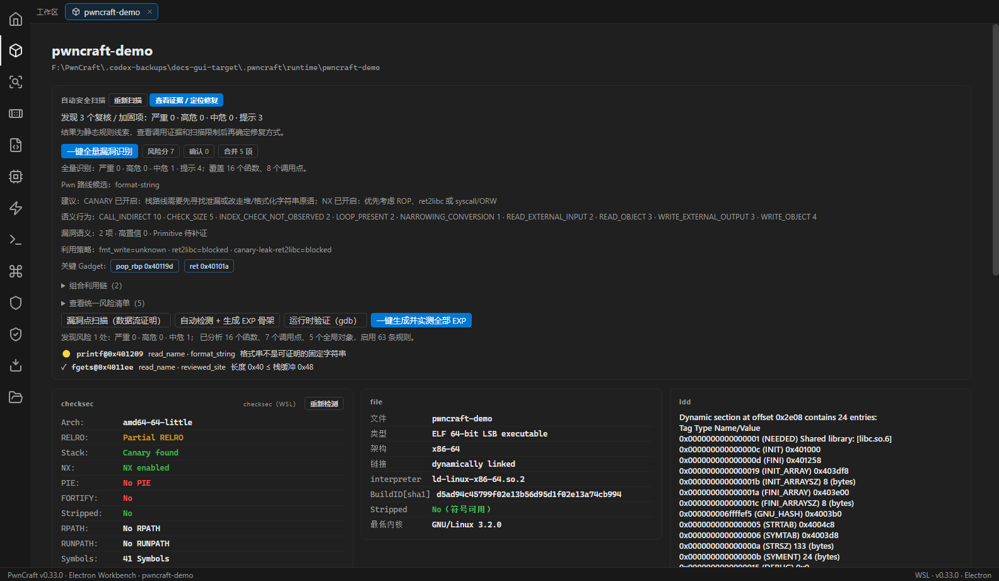
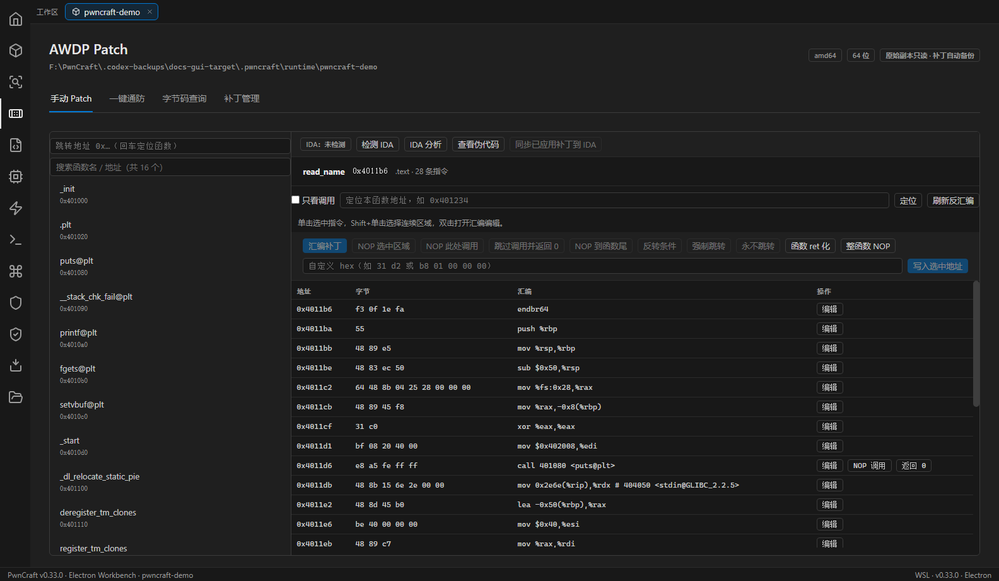

# PwnCraft

面向 CTF Pwn 与 AWDP 的 Windows 桌面工作台。通过 Electron GUI 编写 EXP、查看二进制信息、回放堆操作、构造 ROP，并在 WSL 中运行命令与调试目标。



*Electron Workbench v0.33.0 实际运行截图。图中加载了内置的 tcache 入链顺序模板，堆状态由 Python 分配器模型计算。*

[GUI 使用说明](docs/GUI_GUIDE.md) · [功能与实现说明](pwncraft/README.md) · [架构文档](pwncraft/docs/architecture/ARCHITECTURE.md)

## 主要功能

| 工作区 | 用途 |
| --- | --- |
| Binary / 代码分析 | 查看 ELF 架构、保护、符号与汇编函数，检查静态扫描线索及调用证据 |
| EXP 编辑器 | Monaco 编辑器、pwntools 代码补全、代码块插入与脚本保存 |
| Heap / IO FILE | EXP 语义回放、glibc 分配器模型、chunk 与 bin 画布、IO FILE 字段与约束 |
| ROP / Gadget | 调用 ROPgadget、筛选与收藏 gadget、构造利用链 |
| Format / Stack / Syscall | 格式化字符串写入规划、cyclic 偏移、泄漏计算、ORW 与 SROP 辅助 |
| 调试 / 终端 | WSL bash 多实例终端、隔离的 pwndbg-mogai 调试环境 |
| Seccomp / AWDP Patch | 查看 seccomp 规则，预览、应用、撤销和导出 ELF 字节补丁 |

Electron 负责界面、编辑器和终端；Python 桥负责分析与状态计算。堆画布展示模型回放结果，具体目标的运行行为通过调试验证。

## 快速启动

运行环境：Windows、Node.js LTS / npm、Python 3.10+，以及可运行 bash 和相关 Linux 工具的 WSL。各模块依赖见 [环境准备](docs/GUI_GUIDE.md#环境准备)。

在 PowerShell 中执行：

```powershell
git clone https://github.com/YHalo-wyh/PwnCraft.git
cd PwnCraft
python -m pip install -r .\pwncraft\requirements.txt
cd .\pwncraft\pwncraft-electron
npm install
npm start
```

依赖安装完成后，也可在仓库根目录双击 `启动新版.bat` 启动。当前 GUI 入口是 `pwncraft/pwncraft-electron/`。

启动后拖入 ELF，或按 `Ctrl+O` 选择文件。各工作区共用当前 Target；按 `Ctrl+K` 打开命令面板，按 `Ctrl+反引号` 显示或隐藏终端。

<details>
<summary>更多运行截图：Binary 与 AWDP Patch</summary>

### Binary 概览



### AWDP Patch



</details>

## 目录导航

```text
PwnCraft/
├─ docs/GUI_GUIDE.md          GUI 安装、操作与常见问题
├─ docs/screenshots/          GUI 运行截图
├─ pwncraft/
│  ├─ pwncraft-electron/      Electron 主程序
│  ├─ pwncraft/               Python 桥、分析与状态模型
│  ├─ tests/                  自动化测试
│  ├─ third_party/            pwndbg-mogai 等集成组件
│  └─ docs/                   架构、变更与验收记录
├─ 启动新版.bat               Windows 启动入口
└─ 启动新版.ps1               PowerShell 启动入口
```

第三方组件说明见 [THIRD_PARTY_NOTICES.md](pwncraft/THIRD_PARTY_NOTICES.md)。
