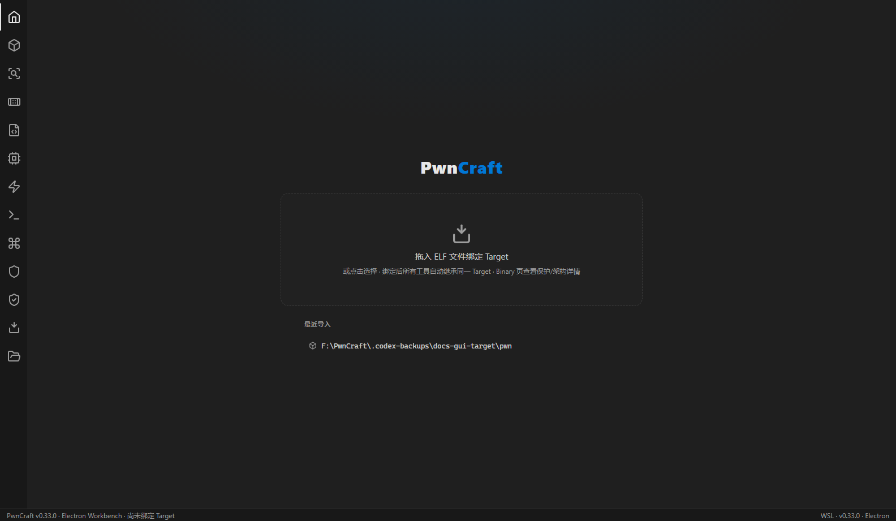
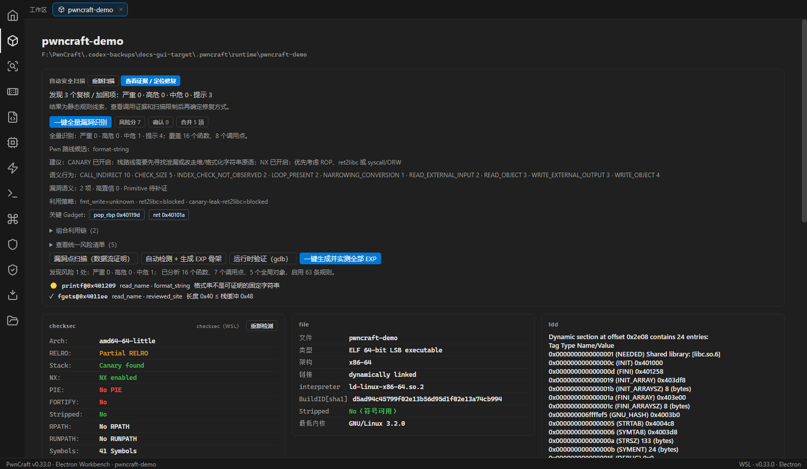
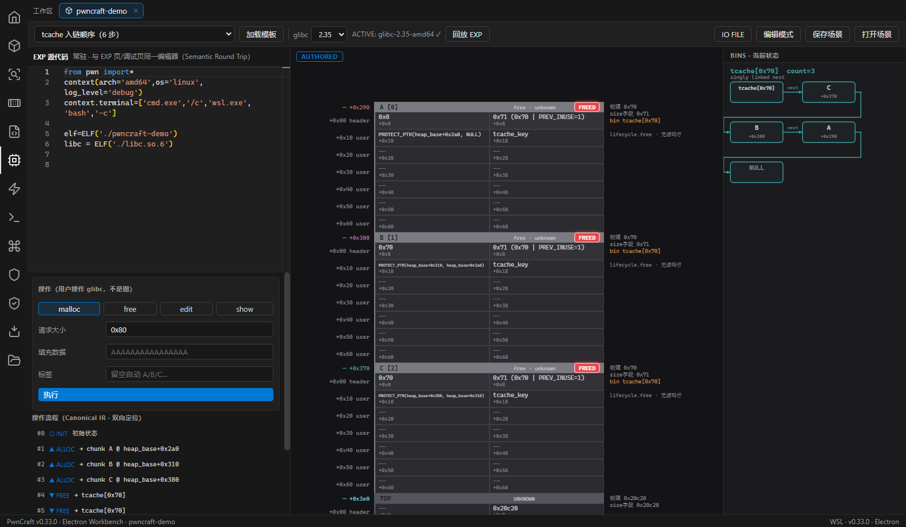
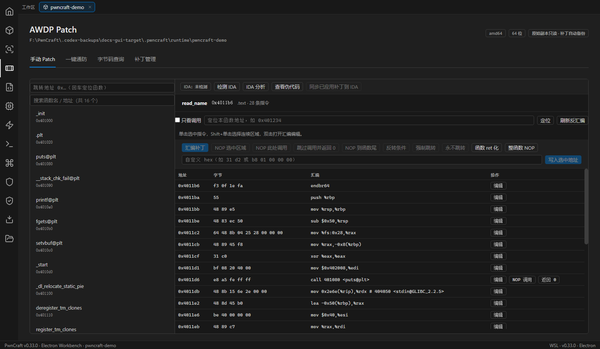

# PwnCraft GUI 使用说明

PwnCraft 将二进制分析、EXP 编辑、堆状态回放、ROP 构造、调试和 AWDP 补丁操作放在同一个桌面工作台中。当前主程序为 `pwncraft/pwncraft-electron/`，界面由 Electron、Monaco 和 xterm.js 组成，分析与状态计算通过 stdio JSON-RPC 调用 Python 桥。

本文界面与截图对应 Electron Workbench v0.33.0。

## 环境准备

| 环境 | 要求与用途 |
| --- | --- |
| Windows | 当前桌面主程序的运行平台 |
| Node.js / npm | 使用 Node.js LTS，安装并启动 Electron 与终端组件 |
| Windows Python | Python 3.10+，运行 `pwncraft.electron_bridge`；依赖位于 `pwncraft/requirements.txt` |
| WSL | 可用的 Linux 发行版与 bash，承载命令行工具和目标调试 |
| Linux 分析工具 | `file`、`readelf`、`objdump`、`checksec`，供 Binary 与代码分析使用 |
| 利用与调试工具 | 按功能安装 GDB、pwntools、ROPgadget、ropper、one_gadget、seccomp-tools、patchelf 等 |
| 可选组件 | IDA 集成、本地 LM Studio 或 OpenAI-compatible 模型服务 |

Windows Python 与 WSL Python 分别用于桥进程和 Linux 运行环境，依赖需要安装到相应环境中。缺少某个可选工具时，对应功能会报告不可用或执行失败。

## 安装与启动

### 首次启动

在 PowerShell 中，从仓库根目录执行：

```powershell
python -m pip install -r .\pwncraft\requirements.txt
cd .\pwncraft\pwncraft-electron
npm install
npm start
```

`npm start` 启动桌面窗口，同时创建 Python 桥和 WSL 终端。Electron 页面、编辑器与终端资源从本地加载。

### 日常启动

在仓库根目录双击 `启动新版.bat`，或在 PowerShell 中运行：

```powershell
.\启动新版.ps1
```

启动脚本会定位 Electron 目录，并在缺少 Electron 依赖时执行 `npm install`。Python 依赖与 WSL 工具需要事先准备。

### 启动检查

在 `pwncraft/pwncraft-electron/` 中运行：

```powershell
npm run smoke
```

检查范围包括 Python 桥通信、node-pty 终端、WSL 字节回流及 EXP 代码块插入与编辑。成功时输出 `SMOKE RESULT OK`。该检查覆盖启动链路；各分析、调试和补丁功能仍取决于目标文件及对应工具。

## 界面与导航



左侧活动栏切换工作区，顶部标签管理已导入的目标，底部面板提供终端和“日志 / 诊断”。鼠标悬停在活动栏图标上可查看模块名称；命令面板支持按功能名称搜索。

| 快捷键 | 操作 |
| --- | --- |
| `Ctrl+O` | 选择 ELF 并绑定 Target |
| `Ctrl+K` / `Ctrl+Shift+P` | 打开命令面板 |
| Ctrl + 反引号（&#96;） | 显示或隐藏底部终端 |
| `Ctrl+S` | 保存 EXP |
| `Esc` | 关闭命令面板或当前对话框 |

## 导入目标与查看 Binary

1. 在欢迎页拖入 ELF，或按 `Ctrl+O` 选择文件。
2. 等待目标绑定完成，进入 Binary 概览。
3. 查看架构、位数、保护信息，以及 `file`、`ldd` 等工具输出。
4. 从静态扫描条目进入调用证据或代码分析，定位需要复核的函数。



导入时，工作台在目标目录下创建 `.pwncraft/` 工作区，保存原始副本和运行副本。补丁写入工作副本，原始副本设为只读。导入目录需要有写入权限；后续 Binary、ROP、调试和 Patch 页面继承同一个 Target。

扫描结果提供静态线索及证据。覆盖范围、缺失条件和运行验证结果共同决定某项利用或修复是否成立。

## EXP 编辑器

EXP 页提供 Python 编辑、pwntools 函数与成员补全，以及连接、收发、打包、泄漏和调试等代码块。点击“初始化模板”建立脚本骨架，插入的片段可继续编辑，按 `Ctrl+S` 保存为 Python 文件。

EXP 页、Heap 页和调试页共享同一份编辑器文本。切换工作区后，脚本内容保持一致；在 WSL 终端运行脚本时，使用 Linux 能访问的文件路径，并确保相应环境已安装 pwntools。

## Heap 与 IO FILE

Heap 页左侧显示 EXP 和操作表单，中间显示物理堆，右侧显示 bin 链与相关值。启动后画布为空，数据可通过以下入口产生：

- **加载模板**：选择演示模板，点击“加载模板”，观察 chunk 和 bin 状态。
- **回放 EXP**：将当前脚本交给语义识别器，再由 Python 分配器模型回放操作。
- **操作表单**：执行 `malloc`、`free`、`edit`、`show` 等操作并查看结果。



复现截图中的场景：打开 Heap，选择“tcache 入链顺序（6 步）”，点击“加载模板”，再通过操作流程切换步骤。顶部 glibc 选择器决定分配器模型；查看 chunk 的 header、用户区和右侧 tcache 链可核对每次分配与释放的变化。

“回放 EXP”对脚本进行静态语义识别，不执行任意 Python 代码。自定义菜单 helper、未知分支或无法推导的表达式可能需要函数适配和人工校正。画布展示分配器模型结果，实际进程中的地址、内存与利用效果通过调试核对。

点击“IO FILE”进入结构字段与约束视图；“保存场景 / 打开场景”用于保留或恢复堆场景。

## ROP、Format、Stack 与 Syscall

| 页面 | 典型操作 |
| --- | --- |
| ROP / Gadget | 配置 ROPgadget 参数，筛选 gadget，加入 Shelf，构造 Chain 或 ret2libc 片段 |
| Format String | 查找参数偏移、规划分段写入，预览 payload 后插入 EXP |
| Stack Offset / Leak | 生成 cyclic、计算覆盖偏移、记录泄漏值并推导基址 |
| Syscall / Seccomp | 查询系统调用，规划寄存器与 gadget，生成 ORW / SROP 代码片段 |
| Seccomp 检测 | 调用 seccomp-tools 查看过滤规则与限制 |

生成片段前需要核对目标架构、偏移、地址、泄漏值和工具输出。缺少条件时，页面会显示诊断或未解决项。seccomp-tools 的 `dump` 流程会启动目标程序。

## 调试与终端

通过调试页或命令面板启动 pwndbg-mogai，工作台创建独立终端实例并加载当前 ELF。项目使用仓库内 `third_party/pwndbg-mogai` 的隔离 Fork。

底部终端用于运行 WSL 命令；命令面板中的“新建 WSL bash 终端实例”可创建额外实例。“日志 / 诊断”面板记录桥通信、工具执行与错误信息。目标导入后，终端工作目录会随项目切换。

## AWDP Patch



Patch 页包含“手动 Patch”“一键通防”“字节码查询”和“补丁管理”。常用流程如下：

1. 导入目标，进入 AWDP Patch。
2. 在“手动 Patch”中搜索函数或按地址定位，查看指令和原始字节。
3. 选择指令或区间，配置 NOP、固定返回、条件跳转、汇编或自定义字节操作。
4. 核对预览中的地址、原始字节与替换内容，再应用补丁。
5. 在“补丁管理”中检查或撤销记录，导出 patched ELF、pwntools `patch.py` 或字节 diff。

“一键通防”提供长度收紧、调用点处理、seccomp 与社区 Patcher 等入口；可用操作受目标架构、指令布局和相关依赖限制。导出后需复测程序的正常功能及待修复路径。

## 截图示例

本文四张截图来自 Windows 上实际运行的 v0.33.0，截取时使用 `Ctrl+反引号` 收起底部终端。Binary 和 Patch 页导入的 `pwncraft-demo` 由 [gui_demo.c](examples/gui_demo.c) 编译；Heap 页使用内置“tcache 入链顺序”模板，与演示 ELF 的运行内存独立。

在 WSL 中进入仓库根目录，执行以下命令生成演示 ELF，再通过 GUI 导入 `docs/examples/pwncraft-demo`：

```bash
gcc -g -O0 -fno-pie -no-pie -o docs/examples/pwncraft-demo docs/examples/gui_demo.c
```

不同 GCC、glibc 与工具版本可能改变指令地址、保护信息及扫描结果。演示程序用于观察界面，截图中的扫描提示仍需按证据复核。

## 常见问题

| 现象 | 检查位置 |
| --- | --- |
| 启动脚本提示找不到命令 | 在 PowerShell 中确认 `node --version`、`npm --version`、`python --version` 可用 |
| Python 桥退出或无法连接 | 检查 Windows Python 依赖与“日志 / 诊断”；可用环境变量 `PWNCRAFT_PYTHON` 指定 Python 可执行文件 |
| WSL 终端没有输出 | 检查默认 WSL 发行版及 bash 是否可启动，再运行 `npm run smoke` |
| Binary / ROP 等工具报错 | 在相同 WSL 环境检查对应命令是否位于 PATH，确认目标的 `/mnt/<盘符>/...` 路径可访问 |
| Heap 画布为空 | 显式加载模板、执行操作或回放 EXP；回放失败时查看日志及 helper 识别情况 |
| Patch 没有函数或指令 | 确认导入的是有效 ELF，检查 objdump 输出和代码分析错误；缺少符号时可尝试按地址定位 |
| IDA 或本地模型不可用 | 这两项为可选集成，分别检查对应服务与连接配置 |

更多实现细节见 [功能说明](../pwncraft/README.md)、[架构文档](../pwncraft/docs/architecture/ARCHITECTURE.md) 与 [第三方组件说明](../pwncraft/THIRD_PARTY_NOTICES.md)。
